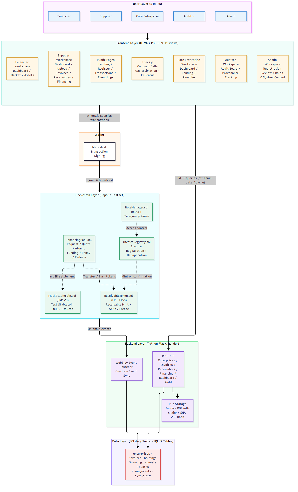
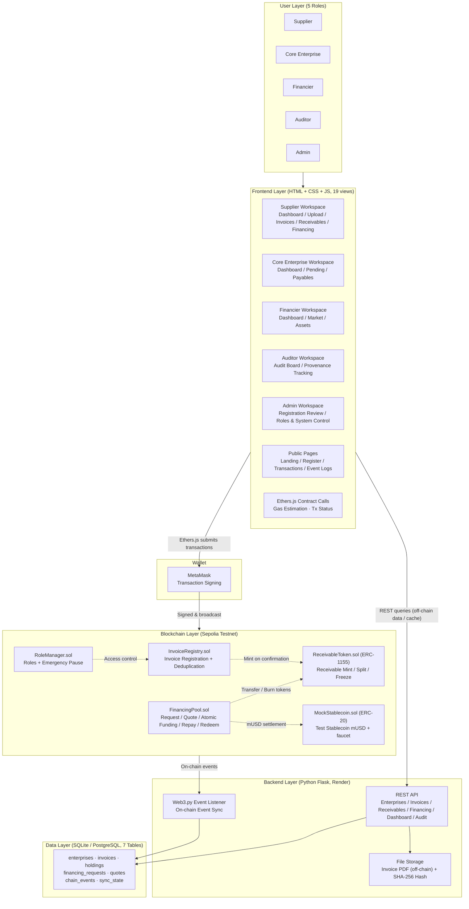
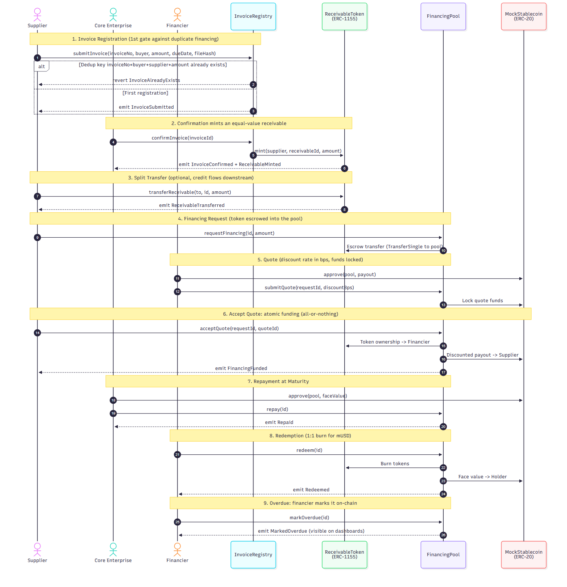
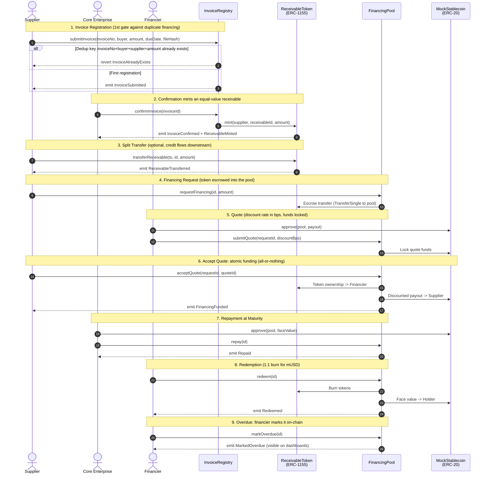
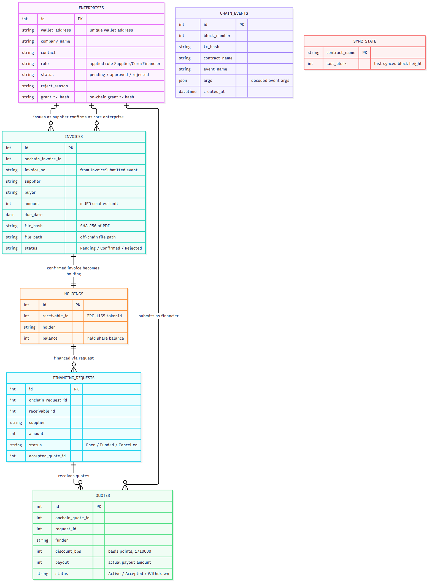
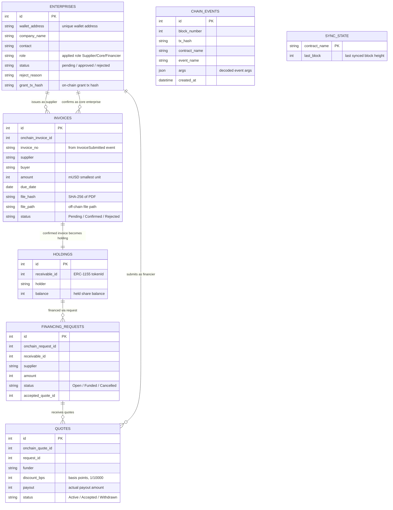
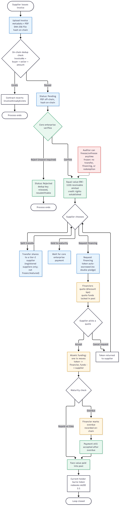
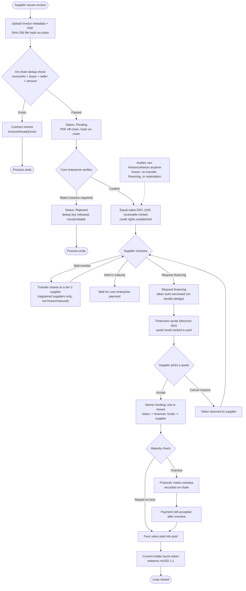
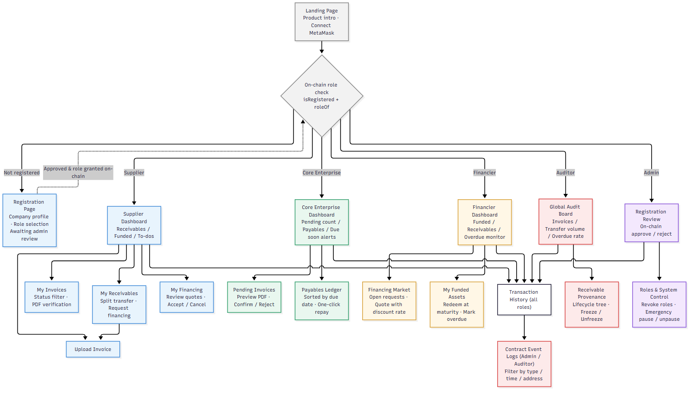
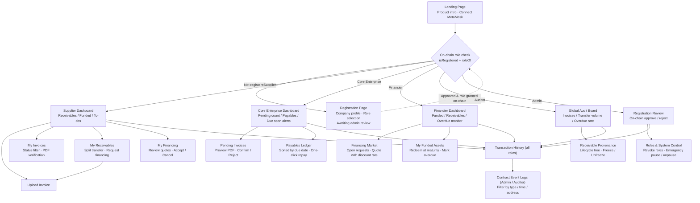

# Diagram Collection (Member 5: System Design & Presentation)

> The 5 diagram types required by the technical report. Each diagram ships as an editable mermaid source (`.mmd`, rendered natively by GitHub) plus an exported PNG for reports and slides.

## 01. System Architecture

Four layers: user layer -> frontend layer -> blockchain layer (Sepolia) + backend layer (Flask/Render) -> data layer; on-chain/off-chain separation of duties, no private keys at the backend.

mermaid source

## 02. Contract Interaction (Sequence)

Invoice registration -> confirmation & minting -> split transfer -> financing request -> quote locking -> atomic funding -> repayment -> redemption / overdue.

mermaid source

## 03. Data Model (ER)

The backend's 7 tables: enterprises, invoices, holdings, financing requests, quotes, chain events, and the sync cursor.

mermaid source

## 04. Business Flow

Core flow: upload -> on-chain dedup -> core-enterprise confirmation -> token minting -> split / finance / hold -> quote & settlement -> repayment -> redemption loop, with reject, cancel, overdue, and freeze branches.

mermaid source

## 05. UI Navigation

Navigation across the 19 pages/views: landing & wallet connect -> role check -> per-role workspaces -> shared transaction history and event logs.

mermaid source

