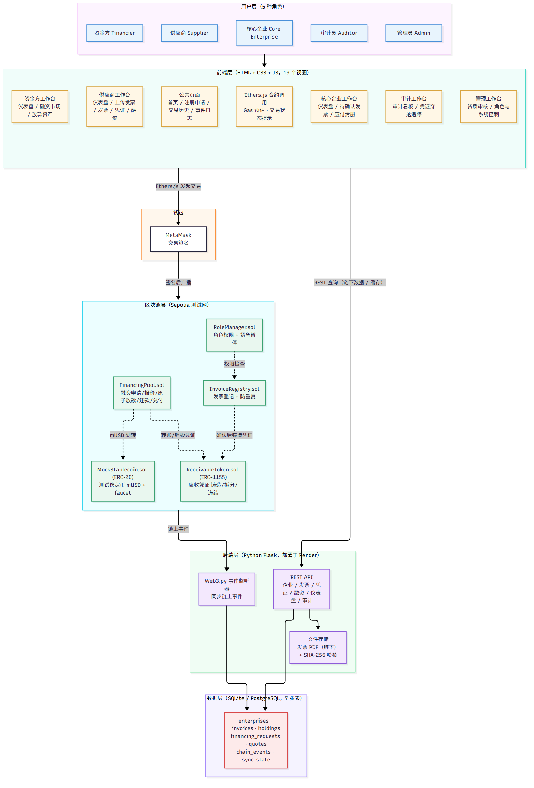
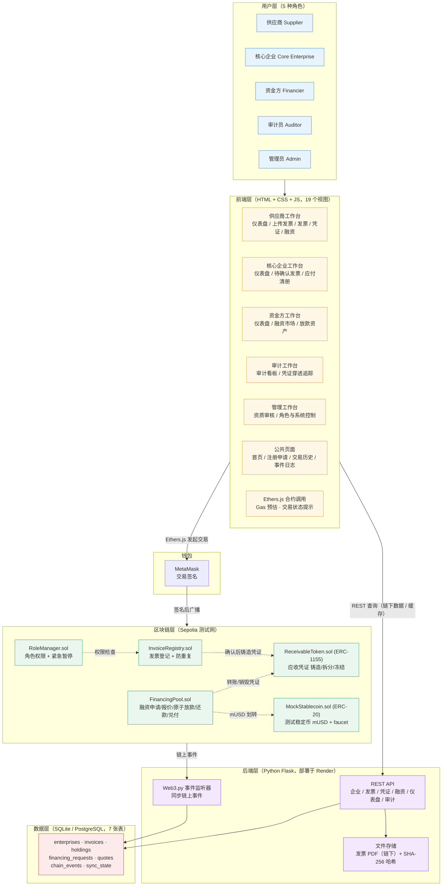
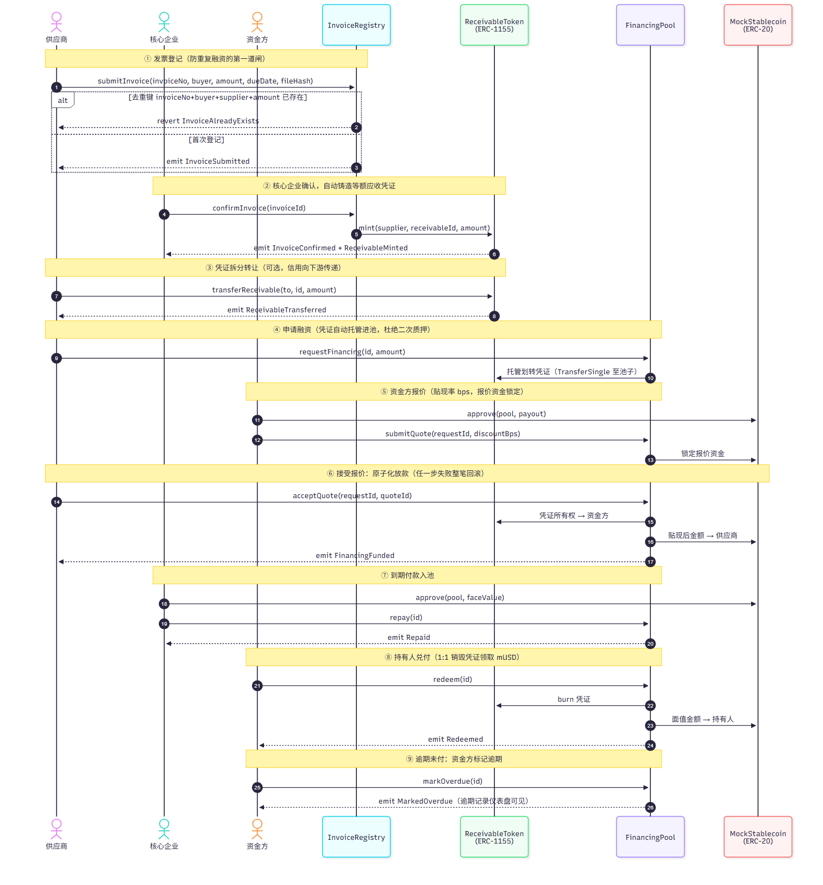
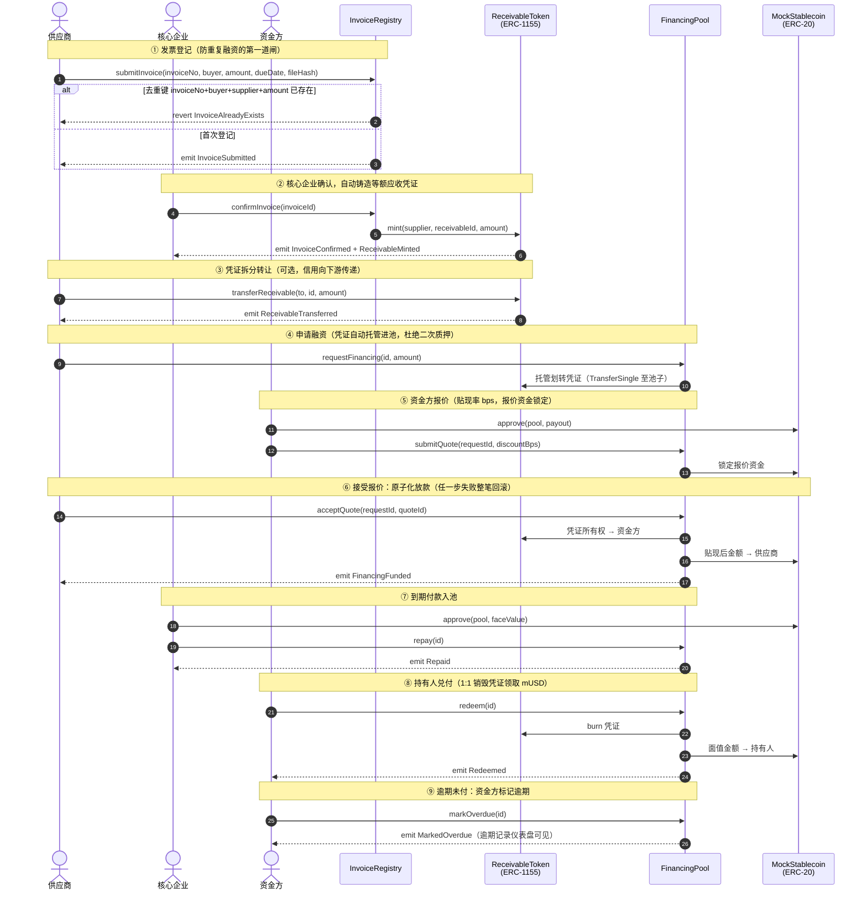
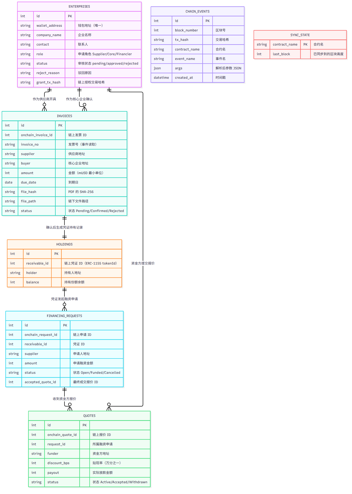
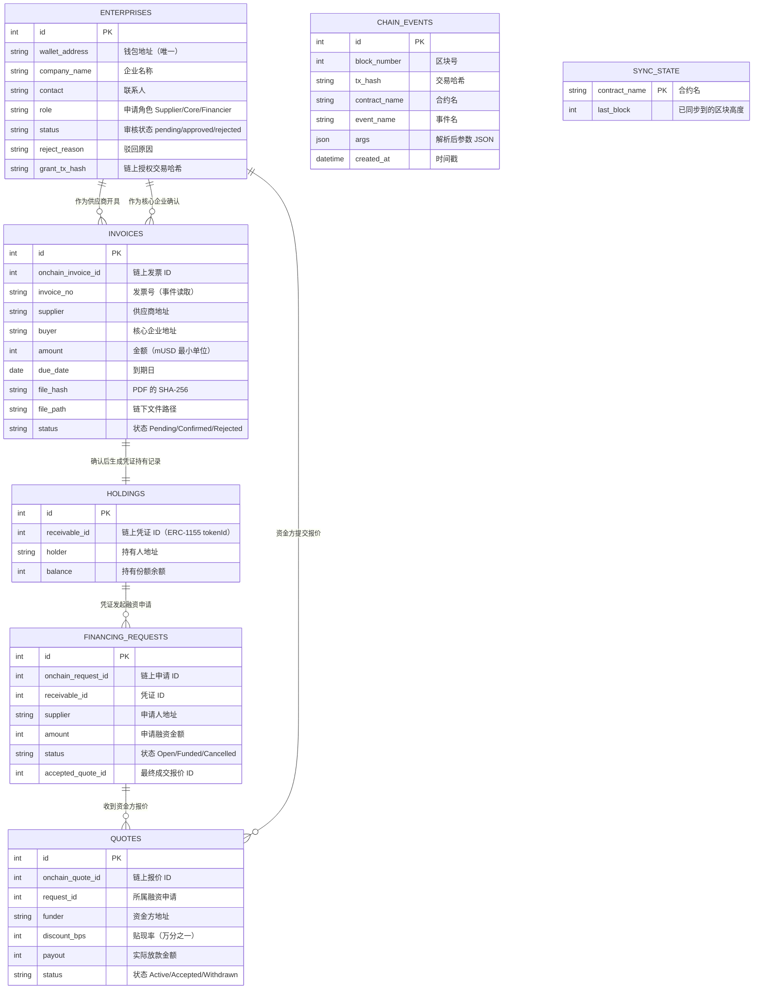
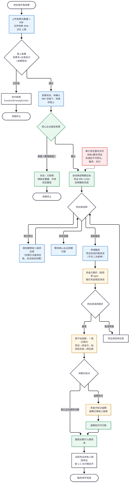
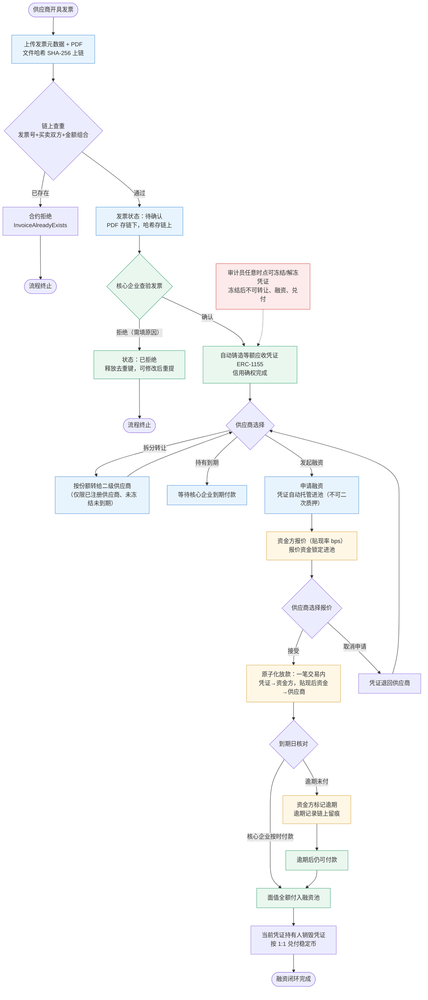
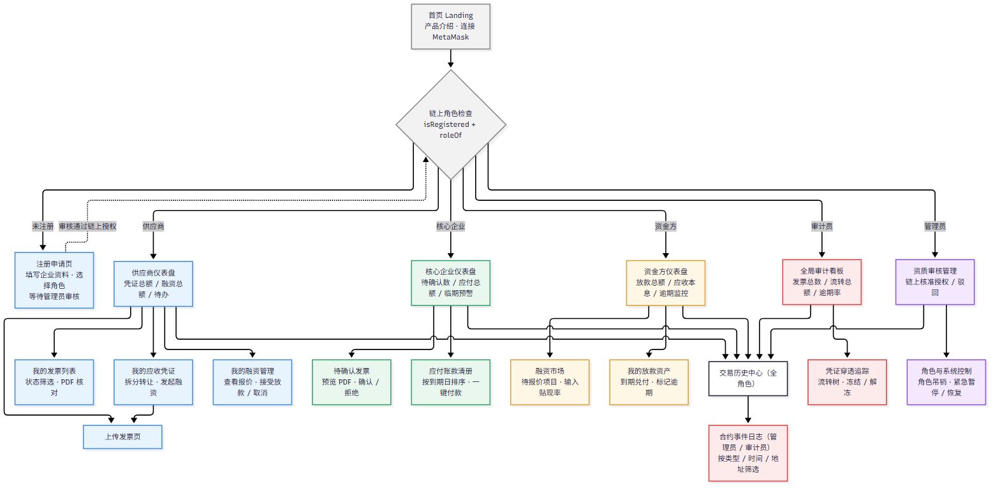
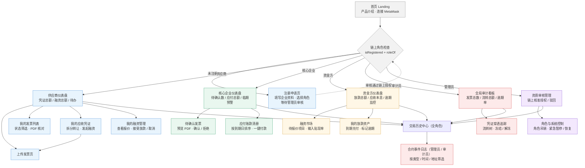

# 设计图集（成员 5：系统设计与演示）

> 本目录收录技术报告要求的 5 类图。每个图提供 mermaid 源码（`.mmd`，GitHub 可原生渲染，可直接编辑）与导出的 PNG 图片（供报告 / PPT 插入）。

## 01. 系统架构图

四层架构：用户层 → 前端层 → 区块链层（Sepolia）+ 后端层（Flask/Render）→ 数据层；链下链上职责分离，后端不存私钥。

mermaid 源码

## 02. 合约交互图（时序图）

发票登记 → 确认铸造 → 拆分转让 → 融资申请 → 报价锁资 → 原子放款 → 到期付款 → 兑付/逾期的完整链上交互时序。

mermaid 源码

## 03. 数据模型图（ER 图）

后端 7 张表的关系：企业、发票、持有记录、融资申请、报价、链上事件、同步游标。

mermaid 源码

## 04. 业务流程图

核心业务流程：上传发票 → 链上查重 → 核心企业确认 → 凭证铸造 → 拆分/融资/持有三选一 → 报价成交 → 到期付款 → 兑付闭环，含拒绝、取消、逾期、冻结分支。

mermaid 源码

## 05. 界面图（页面导航结构）

19 个页面/视图的导航关系：首页连接钱包 → 角色检查 → 各角色工作台 → 公共交易历史与事件日志。

mermaid 源码

